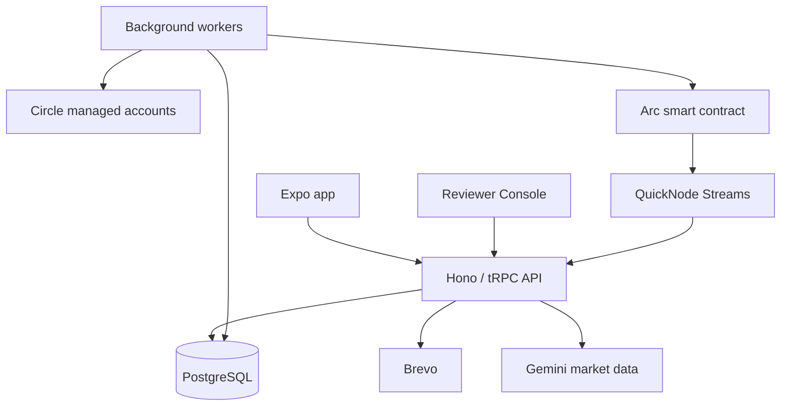

# Hunch

College students make predictions about everything. Whether the class average on the next midterm will be above a 70, if the professor will curve the final, or whether our football team will win this weekend. Hunch gives students a way to actually put money behind those predictions.

Hunch is a prediction market built for college campuses. Students sign up with their school email, create YES/NO markets about campus life, and trade on the outcomes. Independent reviewers settle markets, and winning positions can collect payouts.

Hunch runs on **Arc testnet**, but students don't need to manage wallets, seed phrases, or gas. They see dollar amounts, with fees and totals shown before each purchase.

> **Prototype:** Hunch currently uses testnet funds and simulated deposits, not real-money payments or cash withdrawals.

## How it works

1. **Sign up** with a supported school email and verify it.
2. **Browse or create** YES/NO markets about campus events, with clear rules and deadlines.
3. **Pick a side** and review the amount and 1% fee before purchasing. Free predictions are also supported.
4. **Wait for resolution.** An assigned reviewer confirms the outcome using the market's evidence; linked Gemini markets also require matching settlement data.
5. **Collect** eligible payouts or refunds in Portfolio.

Students can also save markets, follow price history, view campus activity, and track their prediction accuracy.

## Tech stack

| Component | Technology |
| --- | --- |
| Mobile app | Expo / React Native |
| API | Hono + tRPC |
| Database | PostgreSQL |
| Smart contracts | Foundry / Arc testnet |
| Managed accounts | Circle |
| Onchain events | QuickNode Streams |
| Email verification | Brevo |
| External market data | Gemini Prediction Markets |

## Why Arc?

Arc handles market transactions and settlement while Circle-managed accounts keep the blockchain out of the student experience. QuickNode Streams sends contract events to the backend, which updates markets and portfolios. Students interact with familiar dollar amounts rather than crypto tooling.

**Deployed contract:** [`0x73Dd30B231f405C1DCf0812c64dDCc5F02143D20`](https://testnet.arcscan.app/address/0x73Dd30B231f405C1DCf0812c64dDCc5F02143D20)  
**Network:** Arc testnet (chain ID `5042002`)  
**Deployment block:** `72337332`

## Architecture



The API handles student requests. Background workers provision accounts and submit market actions. QuickNode delivers contract events, which the backend processes into market and portfolio updates.

## Getting started

**Requirements:** Bun 1.4.4, Node 22.13+, Docker Desktop, Foundry, and an Expo SDK 58-compatible client. To use the full testnet flow, configure Brevo, Circle, QuickNode, and an HTTPS tunnel.

```powershell
git clone https://github.com/AyeshaSatpathy/UBC-HUNCH.git
cd UBC-HUNCH
bun install --frozen-lockfile
bun run db:up
Copy-Item apps/api/.env.example apps/api/.env
Copy-Item apps/mobile/.env.example apps/mobile/.env
bun run db:migrate
bun run db:seed:campuses
```

Add the required credentials to `apps/api/.env`. Set `EXPO_PUBLIC_API_URL` in `apps/mobile/.env` to `http://localhost:3000` for a local browser or `http://YOUR_PC_WIFI_IP:3000` for a physical phone. Update `CORS_ORIGINS` to match the Expo browser origin.

The API environment includes database, Brevo, Circle, Arc RPC, treasury, signing, and QuickNode settings. Use the `.env.example` files as the source of truth for variable names. Never commit private `.env` files or signing keys.

### Run the app

Run each long-lived process in a separate terminal from the repository root:

```powershell
# API
bun run dev:api

# Mobile app
bun run dev:mobile --go --lan

# Provision new accounts and test credits
bun run --cwd apps/api arc:provision-accounts --follow

# Process market actions
bun run --cwd apps/api arc:student-operations --follow

# Fund eligible reviewer-assigned markets
bun run --cwd apps/api arc:auto-fund --follow

# Index contract events (after configuring QuickNode)
bun run arc:index --streams --follow

# Sample Gemini market prices
bun run --cwd apps/api gemini:sync --follow
```

Workers may submit **real testnet transactions** when work is queued. The automatic funding worker is limited to four successful $20 allocations for this deployment.

### Test on iPhone

Connect your iPhone and computer to the same Wi-Fi. Set `EXPO_PUBLIC_API_URL` to your computer's Wi-Fi IP on port `3000`, then restart Expo. Confirm `http://YOUR_PC_WIFI_IP:3000/ready` opens in Safari and scan Expo's QR code with an SDK-compatible client. A development build can use `bun run dev:mobile --dev-client --lan` instead.

## Login and campus accounts

Students sign up with a supported school email, password, and six-digit email verification code. Returning students log in with their email and password. Sessions persist across app restarts, and passwords are hashed with Argon2id. School matching uses IPEDS and the Hipo university-domain dataset.

After verification, the provisioning worker creates a Circle-managed testnet account and issues a starting balance of **$10 in test funds**. Portfolio supports simulated deposits and displays pending transactions. Purchases include a **1% fee** (for example, $4.00 plus $0.04).

## Market creation and settlement

Students can create YES/NO questions with clear resolution rules, deadlines, and evidence sources. An approved reviewer is assigned separately from the creator and cannot participate in that assigned market.

Markets can optionally link to Gemini Prediction Markets contracts. Hunch pins the selected contract's terms, displays external odds, and checks the settled result before allowing linked-market resolution. Unavailable, changed, or unsettled data blocks that resolution through the app.

The reviewer console is available at `http://localhost:3000/reviewer`. Reviewer setup and manual market funding are covered in [`packages/contracts/README.md`](packages/contracts/README.md).

## QuickNode Streams

QuickNode delivers Arc contract logs to `POST /webhooks/quicknode`. The API checks signed deliveries, deduplicates events, and stores them for the event consumer. The consumer processes events in order so markets and portfolios stay consistent.

To configure it locally:

1. Start the API and expose port `3000` through an HTTPS tunnel, such as `ngrok http 3000`.
2. Set `QUICKNODE_API_KEY`, `QUICKNODE_STREAM_SECURITY_TOKEN`, and `QUICKNODE_WEBHOOK_URL` (ending in `/webhooks/quicknode`) in `apps/api/.env`.
3. Run `bun run --cwd apps/api stream:configure`, verify the Stream in QuickNode, and activate it.
4. Run `bun run arc:index --streams --follow`.

The Stream uses Arc testnet logs for the deployed contract. Historical RPC backfill can be run with `bun run arc:index`. If the tunnel URL changes, update the existing Stream destination rather than creating a new Stream.

## Tests

With Postgres running and migrations applied:

```powershell
bun run typecheck
bun run test
bun run --cwd apps/mobile lint
```

For smart contracts, from `packages/contracts`:

```powershell
forge build
forge test -vv
```

The API exposes `/health` for process health and `/ready` for database readiness.

## Troubleshooting

| Problem | Check |
| --- | --- |
| App cannot reach API | `EXPO_PUBLIC_API_URL`, `/ready`, Wi-Fi, firewall, and `CORS_ORIGINS` |
| Email code not arriving | Brevo credentials, verified sender, and spam folder |
| Account stuck in setup | Circle configuration, funded treasury, and provisioning worker |
| Market awaiting funding | Reviewer assignment, LP funds, and auto-funding worker |
| Market activity not updating | QuickNode Stream, HTTPS tunnel, webhook, and event consumer |
| Gemini history missing | Gemini sampler and available upstream price data |

## Project structure

| Path | Contents |
| --- | --- |
| `apps/mobile` | Student mobile app |
| `apps/api` | API, workers, migrations, and tests |
| `packages/contracts` | Smart contracts, deployment scripts, and contract documentation |

For contract deployment, reviewer assignment, and manual funding, see [`packages/contracts/README.md`](packages/contracts/README.md).
