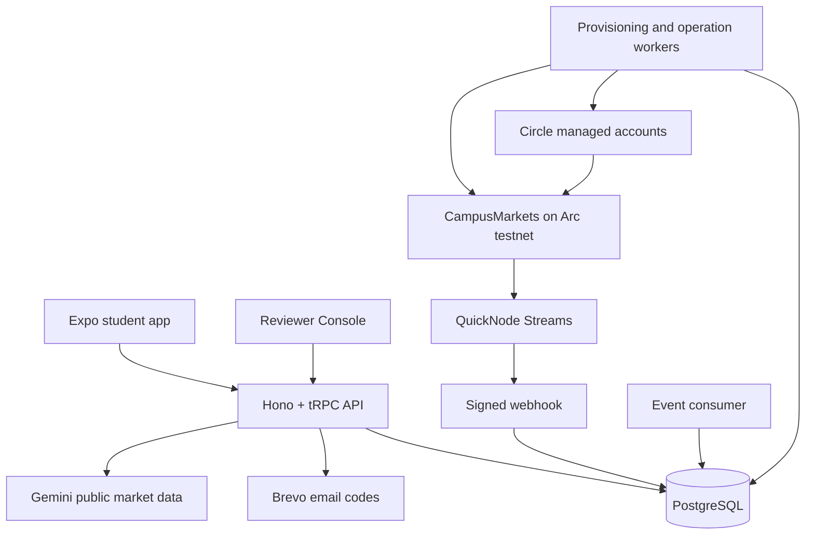

# Hunch

**Your campus. Your call.**

Hunch is a campus prediction market app. Students sign in with their school email, explore questions about their campus, make predictions, and track their positions and reputation. The student experience uses dollars throughout, with a clear fee and total before every purchase.

The project includes an Expo mobile app, a typed Hono/tRPC API, PostgreSQL, contracts on Arc testnet, Circle account provisioning, QuickNode event delivery, Brevo email verification, and Gemini Prediction Markets data.

> Current deployment uses Arc testnet assets. The student interface presents dollar amounts. See [verification status](#verification-status) for the checks completed and the remaining end-to-end gates.

## Find your way

| I want to… | Go to |
| --- | --- |
| Install and configure the project | [Setup](#setup) |
| Understand the components | [Architecture](#architecture) |
| Start the app and workers | [Run the app and services](#run-the-app-and-services) |
| Open Hunch on an iPhone | [iPhone](#iphone) |
| Configure sign-in and school matching | [Login and campus directory](#login-and-campus-directory) |
| Configure live event delivery | [QuickNode Streams](#quicknode-streams) |
| Understand linked market data | [Gemini Prediction Markets](#gemini-prediction-markets) |
| Assign a reviewer and fund a market | [Reviewer Console and market funding](#reviewer-console-and-market-funding) |
| Test the complete experience | [Manual checklist](#manual-checklist) |
| Fix a local setup issue | [Troubleshooting](#troubleshooting) |

## What you can do

- Sign in or create an account using one school-email verification flow.
- Browse campus markets and recent activity, inspect crowd and Gemini odds, and follow price history.
- Create a question with explicit YES/NO rules and optionally pin a matching Gemini contract.
- Review the amount, fee, and total before confirming a purchase.
- Track positions, collect eligible payouts or refunds, and view prediction accuracy and campus rankings.
- Review assigned markets through a separate, access-controlled Reviewer Console.

## Architecture



The API exposes typed reads and durable operation requests. Workers execute account setup and market actions. The event consumer turns contract events into market and portfolio views using atomic cursor advancement and event deduplication. Gemini supplies external odds and settlement evidence for linked contracts.

| Directory | Responsibility |
| --- | --- |
| `apps/mobile` | Expo Router screens, session storage, typed API client and shared UI |
| `apps/api/src/auth` | School email verification and sessions |
| `apps/api/src/arc` | Indexing, provisioning, funding and operation workers |
| `apps/api/src/seed` | Campus imports and the real-testnet lifecycle script |
| `apps/api/migrations` | Versioned PostgreSQL schema changes |
| `apps/api/test` | API integration and validation tests |
| `packages/contracts` | Foundry contracts, tests, deployment and manual funding scripts |

The deployed contract is `0x73Dd30B231f405C1DCf0812c64dDCc5F02143D20` on Arc testnet, chain ID `5042002`, deployment block `72337332`. [Contract setup and manual funding](packages/contracts/README.md)

## Setup

### Prerequisites

| Tool or account | Used for |
| --- | --- |
| Bun 1.4.4 | Workspace installation and scripts |
| Node 22.13 or later | Expo tooling |
| Docker Desktop | Local PostgreSQL |
| Foundry | Contract builds, tests and manual signing |
| Expo SDK 58-compatible client | iPhone preview or development build |
| Brevo sender and API key | School email codes |
| Circle testnet setup | Account creation and transfers |
| QuickNode Streams access | Arc Logs delivery |
| Public HTTPS tunnel | Delivering Stream events to the local API |

Clone the repository and open its root directory.

```powershell
git clone https://github.com/AyeshaSatpathy/UBC-HUNCH.git
cd UBC-HUNCH
```

The following PATH line is specific to the bundled runtimes on the original Windows development PC. If Bun and Node are already on your PATH, start with `bun install`.

```powershell
$env:Path = 'C:\Program Files\nodejs;C:\UBC-HUNCH\.tools\bun-windows-x64;' + $env:Path
bun install --frozen-lockfile
bun run db:up
```

### Configure your environment

For a fresh checkout, create the private environment files once.

```powershell
Copy-Item apps/api/.env.example apps/api/.env
Copy-Item apps/mobile/.env.example apps/mobile/.env
```

Preserve existing environment files. Fill server credentials locally using the variable reference below. Set the mobile API URL to `http://localhost:3000` for a PC browser, or your PC's Wi-Fi address for a physical phone. Set `CORS_ORIGINS` to the exact browser origins you use, including the port. The example permits `http://localhost:8081` and `http://localhost:8082`.

Then initialize the database.

```powershell
bun run db:migrate
bun run db:seed:campuses
```

Postgres runs on `localhost:55432`. Its Docker volume holds the event cursor, session records, operation identities, and funding ledger. Preserve that volume across restarts, including the four-market automatic funding limit.

### Environment variables

All server settings belong in `apps/api/.env` or a server secret store. Git ignores private `.env` files. Only `EXPO_PUBLIC_API_URL` belongs in the mobile environment.

| Variable | Purpose |
| --- | --- |
| `DATABASE_URL` | Postgres connection |
| `PORT` | API port, defaults to 3000 |
| `CORS_ORIGINS` | Comma-separated allowed Expo web origins |
| `BREVO_API_KEY` | Brevo transactional email access |
| `BREVO_FROM_EMAIL` | Verified Brevo sender |
| `AUTH_CODE_SECRET` | 32 random bytes as 64 hex characters, used to hash codes |
| `CIRCLE_API_KEY` | Circle testnet API key |
| `CIRCLE_ENTITY_SECRET` | Registered Circle entity secret |
| `ARC_TESTNET_RPC_URL` | Arc testnet RPC, defaults to `https://rpc.testnet.arc.io` |
| `ARC_TREASURY_ADDRESS` | Dedicated Circle treasury public address |
| `ARC_REGISTRAR_PRIVATE_KEY` | Deployed contract admin signer for account registration |
| `ARC_LP_PRIVATE_KEY` | Existing LP signer for automatic market funding |
| `STARTING_BALANCE_CENTS` | Starting credit, defaults to `1000` ($10.00) |
| `QUICKNODE_API_KEY` | QuickNode management API access for Stream setup |
| `QUICKNODE_STREAM_SECURITY_TOKEN` | Stream delivery HMAC secret, at least 32 characters |
| `QUICKNODE_WEBHOOK_URL` | Public HTTPS URL ending in `/webhooks/quicknode` |
| `EXPO_PUBLIC_API_URL` | Mobile-only URL pointing to the reachable API |

Gemini market-data endpoints used here are public and require no Gemini trading credentials.

## Run the app and services

For a browser preview, start Postgres, the API, and Expo. Account creation and market actions also need their respective workers. Run each long-lived command in its own terminal from the repo root.

| Service | When it is needed |
| --- | --- |
| API | All app requests and webhook delivery |
| Expo | Student app development and preview |
| Stream consumer | Updating market, activity and portfolio projections |
| Provisioning worker | New student accounts and starting credits |
| Student operations worker | Publishing, purchases, predictions and resolutions |
| Automatic funding worker | Opening eligible reviewer-assigned drafts |
| Gemini sampler | Accumulating odds observations over time |

Workers can submit testnet transactions when queued work exists. Run the services needed for the flow you are testing.

```powershell
# API
bun run dev:api

# Primary event consumer, after configuring QuickNode below
bun run arc:index --streams --follow

# New-account wallet creation, campus registration, and $10 credits
bun run --cwd apps/api arc:provision-accounts --follow

# Purchases, predictions, publishing, and reviewer resolutions
bun run --cwd apps/api arc:student-operations --follow

# At most four successful automatic $20 allocations for this deployment
bun run --cwd apps/api arc:auto-fund --follow

# Observe Gemini prices for linked markets even when their screens are closed
bun run --cwd apps/api gemini:sync --follow

# Expo
bun run dev:mobile --go --lan
```

The funding worker checks the deployed LP address and allocation cap. It considers directory-campus drafts with assigned reviewers, simulates the funding call, persists the signed transaction before broadcast, and logs each confirmed or reverted receipt. A database lock serializes reservations across workers. It signs funding calls only. Stop this worker and reconcile any pending transaction before using the LP through the [manual fallback script](packages/contracts/script/fund-market.ps1).

Expo prints the active port and QR code. Open the printed localhost URL for a browser preview. If it selects a new port, add that origin to `CORS_ORIGINS` and restart the API before requesting a code.

For a read-only historical backfill or repair run, use `bun run arc:index`. This reads finalized Arc events from the stored cursor through the current head using RPC. The primary continuous consumer uses `--streams`. Neither mode submits purchases.

### iPhone

1. Put the PC and iPhone on the same Wi-Fi. Run `ipconfig` and find the Wi-Fi IPv4 address.
2. In `apps/mobile/.env`, set `EXPO_PUBLIC_API_URL=http://YOUR_PC_WIFI_IP:3000`. Restart Expo whenever this value changes.
3. Start the API and check `http://YOUR_PC_WIFI_IP:3000/ready` in iPhone Safari. It should return `{"status":"ready"}`. Allow the API and Node through Windows Firewall on your private network if needed.
4. Use an SDK 58-compatible Expo Go installed through your Expo/TestFlight setup, or an SDK 58 development build. Sign in to Expo CLI with `bunx expo login` from `apps/mobile` and use the same Expo account on the iPhone.
5. Run `bun run dev:mobile --go --lan` on the PC and scan the QR with the iPhone camera. Grant local network access to Expo Go.
6. For an installed Hunch development build, run `bun run dev:mobile --dev-client --lan` instead. Rebuild the development client when adding native packages.

The project's SDK version must match the installed client. Expo's current iOS instructions describe TestFlight distribution for newer SDKs and require Apple Developer Program access for that setup. Follow the version-specific installation instructions if an App Store client reports a mismatch. Native iPhone testing remains a manual gate. [Expo iPhone setup](https://docs.expo.dev/get-started/set-up-your-environment/?device=physical&mode=expo-go&platform=ios), [Version compatibility](https://docs.expo.dev/troubleshooting/expo-go-version-mismatch/)

## Login and campus directory

The entry screen separates **Log in** and **Sign up**. Returning students use their school email and password. New students choose a display name and a password of 12–128 characters, then verify a six-digit school email code before their password is saved. Existing accounts retain their campus, balance and provisioning state.

Accounts created before password login was added complete **Sign up** once with their existing school email to establish a password. The verified account and its balance are preserved. **Reset password** handles forgotten passwords for accounts that already have one. A reset cannot establish an initial password, and code-only student login is rejected. A verified password reset revokes prior sessions. Passwords are hashed with Argon2id using 64 MiB of memory and two iterations. Failed and successful password attempts count toward limits of 15 per email and 50 per direct client IP in 15 minutes. Unknown accounts and wrong passwords return the same error.

Sessions last 30 days. The native app keeps its bearer token in Expo SecureStore. The browser preview persists it in local storage across tab and browser restarts and migrates older tab-scoped sessions when reopened. Sign out removes the local token and revokes the current server session. Expired queries and actions return the user to Log in.

A brief custom logo animation plays after successful sign-in or signup and is skipped when reduced motion is enabled. Restoring an existing session opens the feed directly. The feed has only All and My Campus filters, a larger personal greeting, featured markets, horizontal campus collections, existing picks and an account-backed Saved collection. **Explore** is a separate bottom tab for searching and browsing other campuses. Profile lets students edit their display name. Gemini event search uses compact results with bounded scrolling and selectable odds bars with timestamps.

Feed and Portfolio support pull-to-refresh. A first-use card explains predictions, share payouts and fees, with its dismissed state saved per account. Bookmark buttons save markets across sessions. Confirmed purchases show the choice, amount, fee and total before the student opens Portfolio. Pending or failed actions cannot display purchase success.

Codes are HMAC-hashed, expire after ten minutes, allow five attempts, and are consumed once. A resend invalidates prior codes. Limits are one request per minute, five per email per hour, 20 per direct client IP per hour, and 280 app messages per rolling day. A reverse proxy shares the direct-IP bucket unless deployment adds a trusted proxy configuration.

The import uses [IPEDS HD2024](https://nces.ed.gov/ipeds/datacenter/data/HD2024.zip) and the [pinned MIT-licensed Hipo university-domain dataset](https://github.com/Hipo/university-domains-list/tree/a8fb652f5032801de7125a814aedf213b262a1a4). UNITID is the campus ID. The verified import produced 6,040 institutions, 2,025 matched campuses, 2,072 unambiguous .edu domains, and 4,015 campuses without an automatic domain match. Search remains available for every directory campus. Offline imports accept absolute paths to the IPEDS ZIP and Hipo JSON as arguments to `bun run db:seed:campuses`.

Money is represented as six-decimal integers in contract operations and integer-cent strings in the UI API. Displayed charges round up to cents. Balances and payout previews round down. The full six-decimal amount is retained for execution. At $4.00 principal, the fee is $0.04 and the debit is $4.04.

## Account settings and payments

Open **Profile → Settings** to view your verified school email and campus, edit your name, change an existing password with an email code, sign out other sessions, or restore the getting started guide.

Hunch currently uses test credits. After school email verification, the provisioning worker creates a Circle-managed account on Arc testnet, registers the campus, and sends the configured starting credit from the testnet treasury. A purchase uses that balance and includes a 1% fee. The backend submits the approval and purchase through Circle. After a market settles, a successful claim returns any payout or refund to the in-app balance.

Real deposits would need a payment provider approved for the product and jurisdiction. An integration would start with provider-hosted checkout. The backend would record a pending deposit and verify the provider's signed payment events before issuing one credit per confirmed deposit. The production design also needs reconciliation, chargeback and refund handling, and a separate cash withdrawal flow. The local testnet treasury only issues test credits.

## QuickNode Streams

### Required configuration

| Setting | Value and rationale |
| --- | --- |
| Network | Arc Testnet, API slug `arc-testnet`, chain `5042002` |
| Dataset | `logs`, sufficient for the CampusMarkets events |
| Contract | `0x73dd30b231f405c1dcf0812c64ddcc5f02143d20` |
| Historical start block | `72337332`, full history is backfilled through RPC before handing off at the stored cursor |
| End block | Unset, so delivery continues |
| Batch | One block, elastic batching enabled. The Arc Logs service rejects larger batches |
| Region | `usa_east` |
| Filter | [quicknode-filter.js](apps/api/quicknode-filter.js), flattens Logs and keeps only the contract address |
| Destination | Webhook, HTTPS, compression `none`, HMAC security token |
| Delivery retries | 10 retries, five-second intervals, ten-second request timeout |
| Receiver | `POST /webhooks/quicknode` on the Hono API |

The filter preserves batch start/end and returns an object even when its filtered logs are empty. Those empty ranges let the consumer advance its contiguous cursor. Direct Postgres delivery would bypass the receiver's validation and shared projection logic, so this implementation uses the webhook destination.

The receiver verifies HMAC-SHA256 over `nonce + timestamp + decodedBody` using the Stream security token. It validates the contract, network, block ranges, topics, and hashes before storing a durable inbox batch. Retries deduplicate by body digest. The consumer waits for a batch covering its next block, orders logs by block and log index, and commits event insertion, state projection, and cursor advancement together. Event identity includes chain, contract, transaction hash, and log index. Duplicate events leave projections unchanged. Out-of-order deliveries remain in the inbox until preceding ranges arrive.

The app polls Stream-backed activity every five seconds and campus leaderboard statistics every ten seconds. Campus rankings use purchase counts, with market and participant totals. These views become live only when deliveries reach the receiver and the Stream consumer is running.

### Localhost and the public destination

QuickNode needs a publicly reachable HTTPS destination. Start the local API, then run the tunnel in another terminal.

```powershell
ngrok http 3000
```

Use the assigned HTTPS forwarding origin. For example, when ngrok prints `https://YOUR_ASSIGNED_HOST.ngrok-free.app`, the exact destination is `https://YOUR_ASSIGNED_HOST.ngrok-free.app/webhooks/quicknode`. Replace the host with the one assigned to your tunnel. You can obtain the exact active destination in PowerShell.

```powershell
$tunnel = (Invoke-RestMethod http://127.0.0.1:4040/api/tunnels).tunnels |
  Where-Object { $_.public_url -like 'https://*' } | Select-Object -First 1
$tunnel.public_url.TrimEnd('/') + '/webhooks/quicknode'
```

Populate `QUICKNODE_WEBHOOK_URL` with that result and add `QUICKNODE_API_KEY` and `QUICKNODE_STREAM_SECURITY_TOKEN` locally. Run `bun run --cwd apps/api stream:configure`. It creates a paused Stream with a stable external ID, so a retry reuses the same Stream. Inspect it in the QuickNode dashboard, run **Check Connection**, test the filter, and activate it. The configured security token must match the receiver's environment. Restart the API after changing its environment. Run the primary consumer with `bun run arc:index --streams --follow`.

The configured Stream ID is `a2b23407-041b-4af8-82c7-89a0c5a7a356`. The user runs the ngrok tunnel. When its hostname changes, pause this existing Stream, update `QUICKNODE_WEBHOOK_URL` locally and the Stream's destination URL in QuickNode, restart the API, check the connection, and resume delivery. Repeated `stream:configure` calls return the existing Stream unchanged, so they do not update its URL.

On November 18, 2026, the historical RPC backfill completed through block `72903867`. The active Stream was handed off at `72903868`. Signed live deliveries reached block `72903939`, and the Stream consumer advanced the database cursor beyond the handoff to `72903900`. Public Arc RPC backfill requests are paced and retry rate limits with increasing delays. Keep the API, tunnel, and Stream consumer running for ongoing delivery.

Arc Testnet and Logs support, the filter schema, delivery metadata, signature calculation, and Stream creation settings were checked in the current official documentation. [Supported networks](https://www.quicknode.com/docs/streams/supported-chains), [Logs format](https://www.quicknode.com/docs/streams/data-sources/ethereum-evm), [Delivery signatures](https://www.quicknode.com/guides/quicknode-products/streams/validating-incoming-streams-webhook-messages), [Stream creation](https://www.quicknode.com/docs/streams/rest-api/create-stream)

## Gemini Prediction Markets

Create includes an optional Gemini event search. Selecting a contract fills and locks the question, named source URL, and YES/NO rules. Its event ticker, contract ID, contract ticker, and terms fingerprint are pinned on submission and saved when creation confirms. The API fetches the selected contract again before accepting the draft and requires exact matching text. Trading must close by the Gemini expiry, and the evidence deadline must follow that expiry.

Market detail compares campus YES odds with Gemini's last-trade price, falling back to its YES buy quote when there is no last trade. The history chart uses Gemini `priceHistory` when provided and persisted minute observations from the public event endpoint. `gemini:sync --follow` collects observations while screens are closed. It cannot reconstruct price history that Gemini does not return. Sparse histories show an explicit building-history state.

The reviewer console displays the pinned contract's settlement state. A linked resolution requires a fresh response with matching ticker, ID, fingerprint, settled event and contract statuses, a resolution timestamp, and an explicit `yes` or `no`. Pending, invalid, changed, unreachable, and opposite-outcome responses block submission. The worker checks again before sending a new resolution request. These checks are enforced in the application backend. The existing reviewer-only contract still allows a reviewer to submit directly outside the application.

Public Gemini endpoints used are `GET /v1/prediction-markets/events?status=active&search=...` and `GET /v1/prediction-markets/events/{eventTicker}`. Search excludes the digital-asset category from student choices. [Gemini market data documentation](https://developer.gemini.com/prediction-markets-spec/markets)

### Real settled response verified

The adapter fetched this public contract directly by event ticker on November 18, 2026 and returned `YES`. This was a read-only API check.

```json
{
  "eventTicker": "XRP05M2611181915",
  "id": "477697-1209466",
  "ticker": "UP",
  "status": "settled",
  "resolutionSide": "yes",
  "resolvedAt": "2026-11-18T19:15:05.947Z",
  "adapterOutcome": "YES"
}
```

## Reviewer Console and market funding

Open `http://localhost:3000/reviewer` independently of the student app. Approved reviewers sign in by email code. Only marked reviewer accounts can open the console, and it shows only markets assigned to their wallet. It displays the question, named source, evidence deadline, and Gemini settlement check when linked.

A separate verified, provisioned account is required for the reviewer. The creator cannot review their own market, and the reviewer cannot buy or predict in an assigned market. Find the public address with `bun run --cwd apps/api arc:reviewer $reviewerEmail show`, approve it on the contract, then enable console access. Use `disable` to revoke console access.

```powershell
$marketContract = '0x73Dd30B231f405C1DCf0812c64dDCc5F02143D20'
$arcRpc = 'https://rpc.testnet.arc.io'
$cast = '.\.tools\foundry\cast.exe'
# Set $reviewerEmail and $reviewerAddress to the separate reviewer's details.
& $cast send $marketContract 'setReviewer(address,bool)' $reviewerAddress true --account arc-deployer --rpc-url $arcRpc
bun run --cwd apps/api arc:reviewer $reviewerEmail enable
# Set $marketId to the number shown after publishing the student's draft.
& $cast send $marketContract 'assignReviewer(uint256,address)' $marketId $reviewerAddress --account arc-deployer --rpc-url $arcRpc
```

Automatic funding then opens eligible drafts. The last verified vault balance was 86.706667 test USDC, enough for four $20 allocations. Use the local LP keystore fallback if automatic funding is stopped.

```powershell
& .\packages\contracts\script\fund-market.ps1 -MarketId $marketId
```

## Verification status

The November 19 audit removed the unused public notes-write endpoint, capped API request bodies, expanded malformed-webhook checks, and added session expiry handling for failed actions. The student UI explains purchase fees and payouts and hides internal linked-event identifiers.

Run `bun run typecheck`, `bun run test`, and `bun run --cwd apps/mobile lint`. API tests require the migrated and seeded local database. `/health` checks the process, `/ready` checks Postgres, and `GET /webhooks/quicknode` reports whether Stream verification is configured.

- The account redesign verification passed ten API tests with 103 assertions, both workspace typechecks, Expo lint and the production web export. The preceding contract audit passed all 16 Foundry tests, including 256 fuzz runs.
- Browser walkthrough used isolated responses for email login, session restore, logout, purchase response recovery, claim collection, publishing, and Gemini linking with locked terms. It submitted no live purchase.
- Gemini's real settled response was fetched and accepted by the adapter. Pure settlement tests reject changed IDs, tickers, rules, pending and invalid statuses, and absent explicit outcomes.
- Stream receiver tests verify HMAC rejection and duplicate delivery handling. The hosted Arc Logs filter returned the historical vault-deposit event correctly. Real signed QuickNode deliveries reached the Postgres inbox, and public requests with missing or incorrect signatures returned HTTP 401.
- The historical RPC backfill and live Stream handoff completed. Correctly signed wrong-network payloads returned HTTP 400. A newly submitted market event flowing through the Stream into student activity remains a manual check.
- Prior live verification established school email delivery, wallet creation, UT Austin UNITID registration, the $10 credit, and restart recovery. Prior seed settlement and claim behavior were verified on testnet.
- Automatic funding with the LP signer, reviewer-console resolution of a newly Gemini-linked market, sustained Gemini history collection, and this build on a physical iPhone remain manual verification steps.

## Manual checklist

1. For an existing code-only account, complete **Sign up** with your existing school email, name and password, then verify the emailed code. For a new account, use **Sign up** and choose a display name. Sign out and use **Log in** with email and password. Reopen the app or browser and confirm the session persists, then check your existing balance and editable profile name.
2. Open the Explore bottom tab and search campus feeds. Bookmark a market and verify it appears under Saved for later after reopening the app. Dismiss the first-use guide and verify it stays dismissed. With the Stream active, verify a known market event appears once in Live activity and in campus totals after the consumer catches up.
3. In Create, search a Gemini event, select a contract, and inspect the pinned question and rules. Set a future trading close at or before its expiry and an evidence deadline after expiry. Publish and note its market number.
4. Have the admin assign a separate approved reviewer. With auto-funding active, verify the draft becomes Open and that one funding receipt is logged. Check that restarting the worker preserves its four-market limit.
5. Buy YES for $4.00. Confirm the review sheet shows $0.04 fee and $4.04 total. Tap Confirm once, wait for the purchase success screen, then choose View Portfolio and check the balance and position.
6. After trading closes and Gemini explicitly settles, open the separate Reviewer Console. It should show only the reviewer's assignments and permit only Gemini's matching outcome. Add a public reference and submit.
7. In Portfolio, collect the payout or refund once. Confirm the new balance and that the collect button no longer offers a duplicate claim. Check prediction accuracy after a free prediction settles.
8. Temporarily disconnect the API and Gemini connectivity. Confirm errors, retry buttons, and blocked resolution controls. Restore connectivity and verify recovery.

## Troubleshooting

| Symptom | What to check |
| --- | --- |
| Send code fails in the browser | Check `/ready`, the app's API URL, and `CORS_ORIGINS`. The allowed origin must include the current Expo port. Restart the API after changing `.env`. |
| Email does not arrive | Verify the Brevo sender and API key locally, check Inbox and Spam, and wait at least one minute before resending. Codes expire after ten minutes. |
| School domain is unsupported | Directory search covers more schools than the verified domain mapping. Check the imported domain's UNITID mapping. Existing accounts retain their stored campus. |
| Phone cannot connect | Use the PC's Wi-Fi IPv4 address in `EXPO_PUBLIC_API_URL`, join the same network, allow local network access, and open the API `/ready` URL in phone Safari. |
| Expo reports a version mismatch | Install an SDK-compatible client or build a compatible development client. |
| API reports database unavailable | Start Docker, run `bun run db:up`, check the configured port, and apply migrations. |
| Account remains in setup | Check the provisioning worker, Circle configuration, registrar signer, treasury balance and operation status. |
| Market stays awaiting funding | Confirm a separate approved reviewer is assigned, the funding worker is running, the vault has funds and the four-market limit has room. |
| An action stays processing | Check the operations worker and event consumer. Reopen Portfolio to resume status checks. Inspect the existing operation before submitting another request. |
| Activity stops updating | Check the tunnel, Stream destination, Stream status, API and consumer. A missing batch prevents the contiguous cursor from advancing. |
| Stream setup returns an existing Stream | Its stable external ID makes creation idempotent. Update destination settings on the existing Stream when the tunnel changes. |
| Gemini chart has little history | Keep the sampler running. The chart can display only upstream history and observations already collected. |
| Reviewer cannot submit | Check assignment, trading close, evidence deadline and the pinned Gemini status. Linked markets require a matching explicit settled outcome. |
| Public RPC returns 429 | The backfill retries with increasing delays. Resume from the saved cursor if it exits after exhausting retries. |

## Development checks

Run these from the repository root with the migrated local database available.

```powershell
bun run typecheck
bun run test
bun run --cwd apps/mobile lint
```

Run contract checks from `packages/contracts` with Foundry on PATH.

```powershell
forge build
forge test -vv
```

The real-testnet seed entry point is `bun run --cwd apps/api seed:arc`. Review its prerequisites and signing steps in the [contract documentation](packages/contracts/README.md) before running it. It performs real testnet actions and is separate from the local API tests.

### Repository hygiene

Private `.env` files, local tools, keystores, build outputs, Foundry caches and broadcast files are gitignored. Commit `.env.example` templates with variable names and safe defaults. Keep signing material in local environment files or a server secret store.

Preserve PostgreSQL data across restarts. Sessions, provisioning progress, operation identities, the event cursor and the automatic funding limit depend on that state.

## Contract documentation

See [contract setup and deployment](packages/contracts/README.md) for deployment settings, accounting rules, reviewer assignment and manual market funding.
